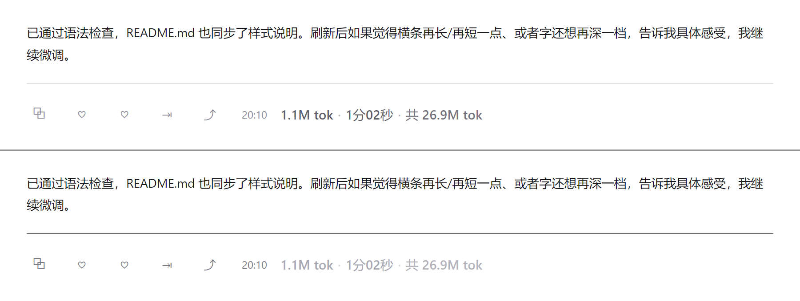

# dsh-token-clock

每条回答的下方，一行淡色读数：**本轮 Token** · **回答耗时** · **本会话累计 Token**。



```
[复制] [赞/踩] [分支] [↗]    20:10   1.1M tok · 1分02秒 · 共 26.9M tok
                                ↑ 官方结束时间   ↑ 本轮     ↑ 耗时     ↑ 会话累计
```

- **本轮 Token**：这一次提问→回答实际消耗的 Token（未缓存输入 + 缓存读取 + 缓存写入 + 输出），来自宿主的 `turn-tail` 节点数据，与官方“用量”弹窗同一口径。
- **回答耗时**：从 `turn/start` 到该轮最终回答落盘（`assistant/message`）的墙钟时间，包含思考与工具调用。
- **会话累计**：整条会话从第一句话到现在的 Token 总和，读宿主 `tokenUsage` 投影，实时更新。
- **常驻可见**：官方动作行只在最后一条回答上常显，历史回答要悬停；本插件仅对含读数的行解除该限制。
- **精确分解**：鼠标悬停读数，可看到未缓存输入 / 缓存读取 / 缓存写入 / 输出 / 其中推理的精确数字。

## 安装

从 npm（如已发布）：

```bash
dsh plugin add dsh-token-clock
```

从 GitHub Release 的 tarball：

```bash
dsh plugin add https://github.com/<owner>/dsh-token-clock/releases/latest/download/dsh-token-clock.tgz
```

从本地目录（开发时）：

```bash
dsh plugin add "C:\path\to\dsh-token-clock"
```

或在 Harness 的插件管理页用“从本地目录安装”指向本目录。安装后刷新一次 Web 页面即可看到读数，不需要重启 `dsh web`。

## 兼容性

- 面向 `@deepseek-ai/dsh-client-ui-chat` / `dsh-client-ui-conversation` 的 `0.2.1-rc.2` 客户端契约（`conversation.chat.turnTail` 槽位、`turn-tail` 节点数据）。
- 纯客户端插件：Host 半边只做日志占位，不注册任何服务、不读写文件、不发网络请求。
- 所有样式都走 `--dsw-alias-*` 主题令牌，深浅色自动跟随；仅注入一个 `<style>` 标签与一个槽位条目。

## 实现要点

| 关注点 | 做法 |
| --- | --- |
| 放置位置 | 注册到 `conversation.chat.turnTail`（`order: -10`），用 `react-dom` portal 把读数接在官方动作行的结束时间之后；取不到动作行时原地降级渲染 |
| 分隔线定位 | `centerRule()` 在 portal 完成后实测“正文底边 → 线 → 动作行顶边”，用 `transform: translateY()` 视觉位移（不动 margin，避免流式渲染时触发滚动锚定跳动） |
| 跟随补底 | 宿主按“撑高后”的内容高度发起平滑滚动，元素塌陷后目标失效会把视图留在半空；插件只在“塌陷前贴底、且不是读者主动滚动”时补一次贴底 |
| 失败策略 | 组件内部 `try/catch`，任何异常都返回 `null`，绝不连累对话界面 |

## 许可

MIT
